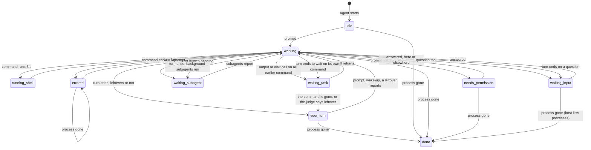

# Agent status

What each agent session is doing, said in one of ten status codes, and how Seal arrives at it.
This is the state machine: every status, every input that drives it, which event moves a session
where, and which signal wins when two disagree.

## One source of truth

Every session has one status: `LiveSession.status`, computed in the main process by the live-session
registry. Every surface reads that field and none computes its own:

| Surface                                                 | Reads                                                         |
| ------------------------------------------------------- | ------------------------------------------------------------- |
| Active agents sidebar, Home, Machines, Project overview | `LiveSession.status` (`liveSessionRegistryStore`)             |
| Session view header, pills, command palette             | the same store                                                |
| Phone and web clients                                   | the same registry, over the runtime RPC                       |
| `seal sessions` CLI, Home chat `list_sessions`          | the registry snapshot                                         |
| Session summaries and recaps                            | the registry's events                                         |
| Desktop notifications                                   | the registry's events (`live-session-notices.ts`)             |
| Terminal tab glyph, workspace card dot                  | the pane's hook row, or its session where discovery knew more |

The predicates every surface shares live in `src/shared/live-sessions/live-session-status.ts`:

| Predicate                        | True for                                                         | Used by                                         |
| -------------------------------- | ---------------------------------------------------------------- | ----------------------------------------------- |
| `isActiveLiveSession`            | a process is seen, or the status is one only a running agent has | every list, badge, count, CLI, Home chat        |
| `isTurnRunningLiveSessionStatus` | `working`, `running-shell`, `waiting-task`                       | recaps (a turn is going), pane roll-ups         |
| `isWaitingOnBackgroundWork`      | `waiting-subagent`, `waiting-task`                               | row and label rendering                         |
| `isSettledLiveSessionStatus`     | `waiting-input`, `your-turn`, `idle`, `waiting-subagent`         | summaries, recaps (there is a stop to describe) |
| `isRestingLiveSessionStatus`     | `your-turn`, `idle`                                              | discovery                                       |
| `liveSessionStatusGroup`         | `attention`, `working`, `idle`, `finished`                       | sort order, counts, notifications               |

Agents that run in a Seal terminal also have a hook row (`AgentStatusEntry`: `working`, `blocked`,
`waiting`, `done`, with `workingMode`, `mainAgent`, `interrupted`). For Claude Code and Codex that
row is one input of the pane's session, not a second status: `sealPanesFromRows` maps it to a
status and `mergeSealPanes` joins it with what discovery read (see
[Seal panes](#seal-panes-hook-rows-against-discovery)). The tab glyph and the workspace dot roll
pane rows up for every agent type; for a pane whose session took its status from discovery they
read the session instead (`live-session-pane-activity.ts`), so they cannot disagree with the
session's row. Providers other than Claude Code and Codex have no session record; their hook row
is their status.

- Model: `src/shared/live-sessions/live-session-status.ts`, `live-session-types.ts`.
- Detector: `src/main/live-sessions/discovery/` (one scan of a machine),
  `src/main/live-sessions/seal-panes/` (Seal's own panes), and
  `src/main/live-sessions/live-session-registry.ts` (hold, unreachable machines, events).
- Labels: `live-session-presentation.ts` on desktop and on mobile.

## Status codes

| Code               | Label                         | Dot          | Whose move      | Meaning                                                              |
| ------------------ | ----------------------------- | ------------ | --------------- | -------------------------------------------------------------------- |
| `needs-permission` | Waiting for approval          | amber, halo  | Yours, now      | A permission prompt or a dialog holds a tool call until you answer.  |
| `waiting-input`    | Asking you a question         | orange, halo | Yours, now      | It asked through its question tool, or its turn ended on a question. |
| `errored`          | Error                         | red, halo    | Yours, now      | The turn failed (API error, crashed tool run).                       |
| `working`          | Working                       | blue spinner | The agent's     | It is generating, or a tool call is in flight.                       |
| `running-shell`    | Running shell                 | solid blue   | The agent's     | A foreground shell command it started is still running.              |
| `waiting-subagent` | Waiting on N subagents        | blue ring    | The agent's     | It waits for subagents it launched, in its turn or after it.         |
| `waiting-task`     | Waiting on N background tasks | blue ring    | The agent's     | It waits on a command or task it started, in its turn or after it.   |
| `your-turn`        | Waiting on you                | green        | Yours, whenever | It finished its turn; what it left running holds nothing.            |
| `idle`             | Idle                          | grey         | Nobody's        | It runs, but has had no turn yet.                                    |
| `done`             | Ended                         | grey         | Nobody's        | Its process is gone.                                                 |

"Waiting on you" is what an ended turn shows (or "Asking you a question", when it ended on one)
unless the agent still waits on something it started. Commands, monitors or a wake-up that merely
outlive the turn are leftovers and hold nothing: they are listed in the session's Tasks panel and
noted beside the status ("2 background tasks still running"), and the next move is the user's. If
one of them wakes the agent, that is a new turn: `working`, then `your-turn` again.

`waiting-task` has two forms:

- Inside a turn, the agent called for the output of a command or task an earlier call started
  (`BashOutput`, `TaskOutput`, Codex `wait` or `write_stdin`), that call has no result yet, and a
  command still runs under the agent.
- After a Claude Code turn, the agent ended its turn to wait on a command it started in the
  background (a loop that sleeps until a job is gone, a build, a test run) and will go on when
  Claude Code wakes it at the command's exit. A dev server or a log tail left running is not that.
  Which of the two an ended turn is cannot be read off a field, so it is judged:
  [An ended turn with commands still running](#an-ended-turn-with-commands-still-running).

Background subagents hold an ended turn the same way: an ended turn with subagents still running
is `waiting-subagent`. Claude Code itself reports that state as `busy`, not as being at its prompt.

The order of the table is the order of every list of running sessions (`compareLiveSessions`).
Colors are existing tokens from `src/renderer/src/assets/main.css`; `LiveSessionStatusDot` is the
one component that draws them:

| Tone (`liveSessionStatusTone`) | Statuses                           | Dot                   | Label text                 |
| ------------------------------ | ---------------------------------- | --------------------- | -------------------------- |
| `busy`                         | `working`, `running-shell`         | `agent-working`       | `text-agent-working`       |
| `waiting`                      | `waiting-subagent`, `waiting-task` | `agent-working` ring  | `text-agent-working`       |
| `approval`                     | `needs-permission`                 | `status-warning`      | `text-status-warning-text` |
| `question`                     | `waiting-input`                    | `agent-question`      | `text-agent-question-text` |
| `turn`                         | `your-turn`                        | `status-success`      | `text-status-success`      |
| `failed`                       | `errored`                          | `destructive`         | `text-destructive`         |
| `quiet`                        | `idle`, `done`                     | `muted-foreground/40` | `text-muted-foreground`    |

`statusDetail` says what the status is about (`Bash: pnpm test`, `Allow Bash: rm -rf build?`, the
question, the error, `Waiting on 2 subagents`, `Interrupted`, and on a resting session what it
left behind: `2 background tasks still running`). `statusSource` says which
signal decided: `seal-hooks`, `agent-hooks`, `agent-state`, `screen`, `process`, `transcript`,
`classifier`.

## Inputs

The rule behind the layering: **the transcript proposes; the agent's own state and the process
tree confirm.** A transcript is a log read in pieces, minutes or megabytes apart. Whatever it says
is still running is checked against what the agent itself reports and what actually runs under it.

| #   | Input                                   | Where it comes from                                                                 | Code                                                                                                                     |
| --- | --------------------------------------- | ----------------------------------------------------------------------------------- | ------------------------------------------------------------------------------------------------------------------------ |
| 1   | Transcript turn                         | Claude `~/.claude/projects/**.jsonl`, Codex `~/.codex/sessions/**/rollout-*.jsonl`  | `claude-transcript-phase.ts`, `codex-transcript-phase.ts`                                                                |
| 2   | Background work the transcript launched | the same logs, folded scan after scan                                               | `claude-transcript-activity.ts`, `claude-background-launches.ts`, `codex-background-terminals.ts`, `session-activity.ts` |
| 3   | The agent's own state                   | Claude Code's registry `~/.claude/sessions/<pid>.json` (`status`, `waitingFor`)     | `claude-session-registry.ts`                                                                                             |
| 4   | Process tree                            | `ps` on the machine: agent processes and every command under them                   | `agent-tool-processes.ts`, `session-process-pairing.ts`                                                                  |
| 5   | Terminal screen                         | tmux `capture-pane`, Seal terminal screen                                           | `agent-screen.ts`, `agent-screen-status.ts`                                                                              |
| 6   | Agent hook file                         | `~/.config/sisomewhere/agents/<id>.json`, written by the agent's hooks              | `agent-hook-states.ts`                                                                                                   |
| 7   | Seal pane hook row                      | the agent-status hooks Seal installs in its own terminals                           | `seal-pane-sessions.ts`, `src/shared/agent-hook-listener/`                                                               |
| 8   | Reply wording                           | the last lines of a finished turn's reply                                           | `reply-ask.ts`                                                                                                           |
| 9   | Classifier                              | the summaries model, for a reply that is unclear                                    | `live-session-reply-asks.ts`                                                                                             |
| 10  | Background wait judge                   | Cloudflare Clef Flash, for a Claude turn that ended with its commands still running | `background-wait-judge.ts`, `live-session-background-waits.ts`                                                           |
| 11  | Scan history                            | the previous scan of the same machine                                               | `live-session-status-hold.ts`                                                                                            |
| 12  | Machine reachability                    | whether the machine's scans succeed                                                 | `live-session-registry.ts`                                                                                               |
| 13  | Pane agent presence                     | a probe of the process a pane's hooks recorded                                      | `seal-pane-runtime.ts`, `agent-hook-server`                                                                              |

A scan runs every 3 s locally and every 8 s over SSH or on a remote server; the same script and the
same assembly run for all three, so every rule below holds on every kind of machine. Timestamps are
compared within one machine only: the scan reports the machine's own clock (`@@NOW`), and every
age is that clock against stamps written on that machine. Clock skew between machines does not
enter status.

### What the transcript records

| The log's newest turn                                                                    | Phase                |
| ---------------------------------------------------------------------------------------- | -------------------- |
| A prompt, reasoning, text with no end record yet                                         | `working`            |
| A tool call with no result                                                               | `tool-pending`       |
| `AskUserQuestion` / `ExitPlanMode` (Claude), `request_user_input` (Codex) with no result | `input-requested`    |
| Codex approval request event                                                             | `approval-requested` |
| End of turn (`turn_duration`, `stop_hook_summary`, `task_complete`)                      | `turn-ended`         |
| End of turn right after an API error record, `turn_aborted` with an error                | `errored`            |
| A scheduled wake-up firing (`system` / `scheduled_task_fire`)                            | `working`            |
| No turn at all                                                                           | `unknown`            |

Claude Code logs each API request before it sends it (`api-request*` records, `prompt_snapshot`
attachments, 40–60 KB apiece). They say nothing about status, so the scan reads the turn's records
from a window eight times the tail it keeps and drops those records first
(`transcript-turn-tail.ts`); a launch is not pushed out of view by the request that followed it.

### Background work

| Agent  | What is tracked                                                              | It ends when                                                                                                                                       |
| ------ | ---------------------------------------------------------------------------- | -------------------------------------------------------------------------------------------------------------------------------------------------- |
| Claude | `Bash` with `run_in_background`, or a command Claude moved to the background | a `<task-notification>` with a `<status>`; or the agent has nothing left running                                                                   |
| Claude | `Monitor` (a watch on a command or a file)                                   | its closing notification, its timeout, or (a command) nothing left running                                                                         |
| Claude | `Agent` / `Task` launched in the background, `Workflow`                      | its notification; a subagent also by its own transcript going quiet                                                                                |
| Claude | `ScheduleWakeup`                                                             | the wake-up fires, or a minute after it was due                                                                                                    |
| Codex  | `exec_command` handed back with "Process running with session ID N"          | Codex writes that the command ended (`CommandExecution` completed); a `write_stdin` poll sees it exit; or no command runs under the agent any more |
| Codex  | helper threads (`spawn_agent`)                                               | the helper's own rollout ends its turn                                                                                                             |

A `<task-notification>` without a `<status>` is a progress event (a Monitor line, a "still
running" check-in). It names a task that is running and never ends it.

"Nothing left running" is the confirmation step. For Claude it is the registry saying `idle`
rather than `shell`; on a build that writes no state, the absence of any command of Claude's Bash
tool under the agent. For Codex it is the absence of any command under the agent. A host that
cannot list processes confirms nothing, and what the transcript says stands.

What is tracked here is listed: a running task appears in the session's activity and in the note
on its resting status. Whether an ended turn waits on one is the next section's question.

### An ended turn with commands still running

A Claude Code turn can end (`stop_reason: end_turn`) while a `run_in_background` command or a
Monitor it started still runs. Two different sessions look alike at that point: one whose agent
started `until ! pgrep -f job.py; do sleep 60; done` and said "the job is still running", and one
whose agent started `pnpm dev` and said "take a look". Claude Code wakes the agent when either
command exits, and its registry says `shell` for both. The first is the agent's move
(`waiting-task`), the second the user's (`your-turn`).

Code settles what it can, in `withBackgroundWait` (`session-status.ts`):

| The ended turn has                                                       | Status                              |
| ------------------------------------------------------------------------ | ----------------------------------- |
| background subagents running                                             | `waiting-subagent`                  |
| no command of its own running                                            | `your-turn`                         |
| a command still running that was started since the user last spoke       | `waiting-task` (the last-turn rule) |
| only commands still running that were started before the user last spoke | `your-turn`, with the leftover note |

The last two rows are a rule of thumb, right for a waiter and for an old dev server, wrong for a
dev server started in the final turn and for a job from an earlier turn the agent still reports
on. So for those two rows discovery attaches the evidence to the session
(`LiveSession.backgroundWait`, built by `claude-background-wait.ts`) and a decision model judges
it:

| Evidence (`BackgroundWaitEvidence`)  | From                                                                                    |
| ------------------------------------ | --------------------------------------------------------------------------------------- |
| `reply`                              | the reply the turn ended on: its first 240 and last 480 characters                      |
| `endedAt`                            | the transcript's last record                                                            |
| `registry`                           | Claude Code's own state (`shell`, `idle`)                                               |
| `commands[].command`, `.description` | the `Bash` or `Monitor` call that launched it                                           |
| `commands[].turn`, `.startedAt`      | whether it was started since the user last spoke (`final`) or before (`earlier`)        |
| `commands[].state`                   | still running, or over (the final turn's finished commands are kept: they are the work) |
| `commands[].runs`                    | the programs under its shell right now (`sleep` for a loop between two checks)          |

The judge is Cloudflare Clef Flash, asked through this host's one path to Clef, the same the
recap's judge uses (`getUtilityModelHost().clef`, `clef-decisions.ts`): OpenRouter when the host
has a key for it, pinned to Cloudflare's own host there, else the Workers AI account. It answers
two `choice` questions about the evidence put into words (`backgroundWaitState`): `standing`
(`waiting`, `leftover` or `other`, with a probability for each) and `reason` (one of a fixed
list, read in the measurement report). The agent waits only when the probability of `waiting` is
above the cut measured for the wording; `leftover` and `other` are both `your-turn`. The verdict
is published with `statusSource: classifier`.

- **A state the host reads whole.** Cloudflare's host may read only about the first 2,000 tokens
  of a state and drop the rest without an error, so the state is never longer than 3,000
  characters (`BACKGROUND_WAIT_STATE_MAX_CHARS`, about half of that in shell text). The reply
  comes first, then the commands with the ones that decide most first: still running before
  finished, started in the final turn before older. A reply keeps both ends within 760
  characters, a command within 320, a description within 160; commands that still do not fit
  are left off the end and counted in `more_background_commands`.

- **Asked once per state.** The answer is kept on the hash of the model and the request body, in
  memory and on disk. The time since the turn ended goes in as one of three steps (under an hour,
  hours, more than a day), so a wait is asked about again at most twice however long it lasts,
  and nothing asks on a timer.
- **Until it answers, and whenever it cannot** (no account for Clef, a timeout, a rate limit, a
  reply that cannot be read, wording whose hash is not the calibrated one), the status the table
  above gave stands. A state that failed is asked about again when an account is whole again.
- **Where it runs.** On the host that summarizes sessions: a desktop judges its own sessions and
  those of its paired servers, which send the evidence with the session
  (`federated-watch-frames.ts`). It is on while session summaries are on.
- **What ends it.** The user speaks, the command exits (Claude Code wakes the agent: `working`),
  or the command is killed: with nothing left running the evidence is gone and the turn is
  `your-turn`.

`BACKGROUND_WAIT_CALIBRATION` pins the model, the hash of the question wording and the cut
together. The cut comes from 44 labelled cases (`background-wait-cases/__fixtures__`): 40 are put
to the model and 4 have nothing running and are settled by code. Half are the tune split, on which
the wording and the cut are set; the other half is held out. Clef Flash's answers are recorded
(`answers-clef-flash.json`), and CI replays the cases through the judge client, its cache and the
status rule with no network (`background-wait-judge.test.ts`). To measure again after a change to
the wording or the cases, on a host with `OPENROUTER_API_KEY` or `~/.config/seal/openrouter.json`
(else a Workers AI credential, whose free daily allocation a full run may not fit in):

```sh
BACKGROUND_WAIT_JUDGE_LIVE=1 pnpm test src/main/session-summaries/background-wait-cases --maxWorkers=1
```

It asks only what is not on record, the tune split first, and asks the held-out split only once
the tune split is separated (`BACKGROUND_WAIT_JUDGE_HELD_OUT=1` asks it regardless). It writes the
answers, `measured.json` and `docs/design/background-wait-judge-report.md`; the calibration in
`background-wait-judge.ts` is then set to what `measured.json` says.

### The agent's own state (Claude Code)

| Registry `status` | Meaning                                               | Effect                                                                                                                                                              |
| ----------------- | ----------------------------------------------------- | ------------------------------------------------------------------------------------------------------------------------------------------------------------------- |
| `busy`            | a turn runs, or work it delegated does                | A turn the transcript ended reads `working` (compaction, a turn not logged yet). No prompt is inferred from a slow call.                                            |
| `shell`           | at its prompt, commands it left in the background run | The turn is over, as for `idle`; whether it waits on those commands is judged (above). They are listed as running, whether or not the scan still sees their launch. |
| `idle`            | at its prompt, nothing of its own running             | Background commands are over. A turn the transcript left open is dropped (`your-turn`).                                                                             |
| `waiting`         | a dialog holds it (`waitingFor` says which)           | `permission prompt` and others: `needs-permission`. `input needed`: `waiting-input`. A dialog the user opened (`dialog open`) is ignored.                           |

The registry speaks for the process's current conversation only, and a state counts over the
transcript only when it was stamped after the transcript's last write.

## State machine



### Transitions

| From                            | Event                                                                                                                                               | To                                    |
| ------------------------------- | --------------------------------------------------------------------------------------------------------------------------------------------------- | ------------------------------------- |
| `idle`, `your-turn`, `errored`  | user prompt; scheduled wake-up fires; a leftover command or monitor reports and the agent resumes                                                   | `working`                             |
| `working`                       | foreground command running for 3 s                                                                                                                  | `running-shell`                       |
| `working`                       | shell call 5 s with no process, edit 8 s with no result (20 s in `auto` mode)                                                                       | `needs-permission`                    |
| `working`                       | approval dialog on screen; registry `waiting`; pane hook `PermissionRequest`                                                                        | `needs-permission`                    |
| `needs-permission`              | answered in Seal, in the terminal, or on another device: the result is written, the dialog leaves the screen, or the registry leaves `waiting`      | `working`                             |
| `working`                       | question tool call pending                                                                                                                          | `waiting-input`                       |
| `working`                       | subagent launch pending (`Agent`, `Task`, `wait_agent`)                                                                                             | `waiting-subagent`                    |
| `working`                       | a call for the output of an earlier command is pending (`BashOutput`, `TaskOutput`, Codex `wait`, `write_stdin`) and a command runs                 | `waiting-task`                        |
| `waiting-task`                  | the call returns; or no command runs under the agent any more                                                                                       | `working`                             |
| `working`                       | turn ends; reply tells; background commands, monitors, workflows or a wake-up may remain                                                            | `your-turn`, detail the leftover note |
| `working`                       | Claude turn ends; a command it started since the user last spoke still runs, or the judge says the agent waits on one                               | `waiting-task`                        |
| `waiting-task` (turn ended)     | the command exits and Claude Code wakes the agent                                                                                                   | `working`                             |
| `waiting-task` (turn ended)     | the command is killed, or the judge says it is a leftover                                                                                           | `your-turn`                           |
| `working`                       | turn ends; reply asks (wording, or the classifier)                                                                                                  | `waiting-input`                       |
| `working`                       | turn ends; background subagents still run                                                                                                           | `waiting-subagent`                    |
| `working`                       | turn fails (API error, `StopFailure`, `turn_aborted` with an error)                                                                                 | `errored`                             |
| `working`                       | interrupted (Esc, Ctrl-C)                                                                                                                           | `your-turn`, detail `Interrupted`     |
| `waiting-subagent`              | the subagents report and the agent takes a turn                                                                                                     | `working`                             |
| `waiting-subagent`              | the subagents ended (their notice, or their transcripts going quiet)                                                                                | `your-turn`                           |
| `your-turn` with leftovers      | a leftover ends by itself or is killed outside the agent                                                                                            | stays `your-turn`; the note drops it  |
| any but `errored`               | the agent's process, seen by an earlier scan, is off the host's process list; or no process was ever seen and the transcript is quiet for 2 minutes | `done`                                |
| `waiting-input` (question tool) | process gone, on a host that cannot list processes                                                                                                  | stays `waiting-input`                 |
| `errored`                       | process gone; a `done` or `idle` hook arrives                                                                                                       | stays `errored`                       |
| any                             | the machine stops answering for three scans in a row                                                                                                | not shown, machine marked unreachable |

`done` needs the process to be gone, not merely unseen. A transcript written in the last 2 minutes
(`FRESH_WRITE_MS`) belongs to a running agent even if `ps` missed it, unless an earlier scan paired
that transcript with a process which the host's list no longer shows: that agent exited, and its
session ends at this scan, whether it was killed or left by itself (Claude writes its closing
records on its way out, so its transcript is at its freshest then). A prompt or a question is
written to the transcript once and then nothing more until it is answered, so a quiet transcript
does not end it: only a host that listed its processes (`@@PS`) and has nobody left holding the
session does. A Codex thread held open by a shared `codex app-server` is still held.

## Precedence

Read top to bottom; the first row that matches wins.

| #   | Signal                                                                                      | Status                               | Source        |
| --- | ------------------------------------------------------------------------------------------- | ------------------------------------ | ------------- |
| 1   | Approval dialog on screen                                                                   | `needs-permission`                   | `screen`      |
| 2   | Other dialog on screen while the turn is busy                                               | `needs-permission`                   | `screen`      |
| 3   | Seal pane hook says a permission or question is pending                                     | `needs-permission` / `waiting-input` | `seal-hooks`  |
| 4   | Transcript: question tool pending, agent not known to be gone                               | `waiting-input`                      | `transcript`  |
| 5   | Claude registry `waiting` on a prompt or a question                                         | `needs-permission` / `waiting-input` | `agent-state` |
| 6   | Agent hook file says a prompt is pending, agent not known to be gone, turn not ended since  | `needs-permission`                   | `agent-hooks` |
| 7   | Agent hook file says working, agent not known to be gone, turn not ended since              | `working`, refined by rows 11–14     | `agent-hooks` |
| 8   | Transcript: the turn failed (whatever a later `done` or `idle` hook says)                   | `errored`                            | `transcript`  |
| 9   | Process gone                                                                                | `done`                               | `transcript`  |
| 10  | Claude registry `idle`, stamped after a turn the transcript left open                       | `your-turn`                          | `agent-state` |
| 11  | Transcript: subagent launch pending                                                         | `waiting-subagent`                   | `transcript`  |
| 12  | Pending shell call, its command process running for 3 s                                     | `running-shell`                      | `process`     |
| 13  | Pending call for an earlier command's output, a command running under the agent             | `waiting-task`                       | `process`     |
| 14  | Pending shell or edit call, nothing running, past the prompt threshold, registry not `busy` | `needs-permission`                   | `process`     |
| 15  | Transcript: turn in progress                                                                | `working`                            | `transcript`  |
| 16  | Turn ended, Claude registry `busy`                                                          | `working`                            | `agent-state` |
| 17  | Turn ended, interrupt hint on screen                                                        | `working`                            | `screen`      |
| 18  | Turn ended, background subagents running                                                    | `waiting-subagent`                   | `transcript`  |
| 19  | Turn ended, reply ends in a question                                                        | `waiting-input`                      | `transcript`  |
| 20  | Claude turn ended, a command of its own still runs, the judge says the agent waits on it    | `waiting-task`                       | `classifier`  |
| 21  | Claude turn ended, a command it started since the user last spoke still runs, no verdict    | `waiting-task`                       | `transcript`  |
| 22  | Turn ended, reply unclear, classifier says ASKS                                             | `waiting-input`                      | `classifier`  |
| 23  | Turn ended, with or without commands, monitors or a wake-up left running                    | `your-turn`                          | `transcript`  |
| 24  | No turn yet                                                                                 | `idle`                               | `transcript`  |

An explicit question (row 4) outranks a wait (row 18): a session that asks and also has
subagents running is asking. A turn whose commands the judge called leftovers is row 23, with the
source `classifier`. A hook file older than the transcript by 2 minutes (`HOOK_STALE_MS`) is
ignored. A hook file that says `working` or `needs` more than 3 s before the transcript recorded
a settled end of turn is left over from an interrupted turn, for which no hook fires, and is
ignored too.

### Seal panes: hook rows against discovery

A pane's hook row maps to a status first (`hookStatus` in `seal-pane-sessions.ts`):

| Hook row                                              | Pane status                                             |
| ----------------------------------------------------- | ------------------------------------------------------- |
| `blocked`                                             | `needs-permission`                                      |
| `waiting` on a question tool                          | `waiting-input`                                         |
| `waiting` on anything else                            | `needs-permission`                                      |
| main agent ended in a failure (`mainAgent.outcome`)   | `errored`                                               |
| `done`                                                | `your-turn` (detail `Interrupted` when the row says so) |
| `working`, `workingMode: 'monitoring'`                | `your-turn` (shells and monitors it left still run)     |
| `working`, main agent done, held open by child agents | `waiting-subagent`                                      |
| `working`                                             | `working`                                               |

Then the scan's reading of the same session is joined in (`mergeSealPanes`). Hooks are events and
are trusted for what they can say; discovery fills in what they cannot:

| Pane says            | Discovery read                                                  | Shown                              |
| -------------------- | --------------------------------------------------------------- | ---------------------------------- |
| anything             | an approval dialog on screen                                    | discovery                          |
| anything             | a classifier verdict                                            | pane                               |
| silent pane          | anything                                                        | discovery                          |
| `your-turn`          | `waiting-subagent`, `waiting-input`, `errored`                  | discovery                          |
| `your-turn`          | `waiting-task`, read with what the ended turn left running      | discovery                          |
| `your-turn`          | the agent's own state says `working`, a prompt or a question    | discovery                          |
| `working`            | `running-shell`, `waiting-task`, `waiting-subagent`             | discovery                          |
| `working`            | the agent's own state says a prompt or a question               | discovery                          |
| `working` (local)    | the transcript ended the turn more than 3 s after the last hook | discovery (`your-turn`, `errored`) |
| `waiting-subagent`   | a wait                                                          | discovery                          |
| a prompt or question | anything but a dialog on screen                                 | pane                               |
| anything else        |                                                                 | pane                               |

A pane is silent when its row was restored at startup and not confirmed since, or when it is not
`done` and has had no hook evidence for 30 minutes (`AGENT_STATUS_STALE_AFTER_MS`). A silent pane
speaks for nothing; the scan decides.

A hook reaches Seal before the next scan does, so a pane that takes another status is ahead of what
discovery last read of its session (a prompt just answered, a background command that just ended).
The registry republishes on every hook, and on a change of status it reads the pane's machine again
within half a second instead of waiting for its next scan (`SealPaneStatusChanges`).

## Lifecycle cases

| Case                                         | What happens                                                                                                                                                                                                                                                                                      |
| -------------------------------------------- | ------------------------------------------------------------------------------------------------------------------------------------------------------------------------------------------------------------------------------------------------------------------------------------------------- |
| Machine disconnects                          | Its scans fail. After three failures in a row its sessions are dropped and the machine shows its error; nothing keeps the status it had.                                                                                                                                                          |
| Machine reconnects                           | The first scans list its sessions again with their current status. A remote scan reads a few transcripts at a time, and a running agent is listed once its own is read, never as `idle` or under another session before. Background work is rebuilt from the transcript and confirmed.            |
| A scan is cut short (read budget, timeout)   | The previous list is kept for that scan, and the hold keeps a busy session busy until a second scan agrees (20 s at most).                                                                                                                                                                        |
| App restart                                  | External sessions are rediscovered by the first scan. Pane rows restored from disk are silent until a hook confirms them.                                                                                                                                                                         |
| New agent where an earlier session ended     | Claude names its conversation in its registry before it writes a transcript: the agent is its own new session, and the earlier one stays ended instead of reading as running again.                                                                                                               |
| Agent killed in a Seal pane (no hooks fire)  | The scan sees no process for the pane's session; Seal probes the process the hooks recorded (at most every 15 s per pane) and ends the row.                                                                                                                                                       |
| Agent killed, or leaving by itself (`/exit`) | `done` at the scan that finds its process off the host's list, when an earlier scan saw it; otherwise once the host has listed its processes, nobody holds the session and its transcript is 2 minutes quiet.                                                                                     |
| Interrupted turn (Esc, Ctrl-C)               | The transcript records the end; a stale `working` hook file or pane row from before it is overruled. Shown as `your-turn`, `Interrupted`; a command the turn left behind stays listed as running (Codex keeps a command it was polling in its terminal).                                          |
| Compaction                                   | Runs inside a turn. The Claude registry says `busy` throughout, so a transcript that reads as ended still shows `working`.                                                                                                                                                                        |
| Subagents                                    | A pending launch is `waiting-subagent`; background subagents hold an ended turn in `waiting-subagent` until each reports or goes quiet.                                                                                                                                                           |
| Commands and monitors left running           | A Claude turn that ended to wait on one is `waiting-task` until it exits and wakes the agent. Any other ends in `your-turn` with the note "N background tasks still running". Each wake-up they cause is a turn of its own: `working`, then `your-turn` again, the note counting what still runs. |
| Prompt answered elsewhere                    | The result lands in the transcript, the dialog leaves the screen, or the registry leaves `waiting`; any one returns the session to `working`.                                                                                                                                                     |
| Hooks out of order or duplicated             | A status is a function of the newest state, not of the sequence: a repeated hook changes nothing, and a late `done` cannot hide an `errored` turn.                                                                                                                                                |
| Failed turn, then a `done` or `idle` hook    | `errored` stays, while the agent runs and after it exits.                                                                                                                                                                                                                                         |
| Clock skew between machines                  | No effect: ages compare one machine's clock with stamps written on it. The pane rule that compares a hook's time to a transcript's is local-only.                                                                                                                                                 |

## Agents

| Agent                                                                                                | Session record | Signals                                                                                                                                                        |
| ---------------------------------------------------------------------------------------------------- | -------------- | -------------------------------------------------------------------------------------------------------------------------------------------------------------- |
| Claude Code                                                                                          | yes            | all thirteen inputs                                                                                                                                            |
| Codex                                                                                                | yes            | transcript, background terminals and helper threads, process tree (its own process and any `codex app-server`), screen, hook file, pane row, reply, classifier |
| Kimi, Copilot, Jcode                                                                                 | no             | pane hook row; a failed turn is recorded as a failure (`StopFailure`, a non-recoverable `ErrorOccurred`, `turn_end` with `status: error`)                      |
| Claude-compatible agents (Qoder, Qwen Code, CodeBuddy, Grok, Muse, …)                                | no             | pane hook row through the shared lifecycle mapping, including `StopFailure` and interrupts                                                                     |
| Gemini, Cursor, Kiro, DSH, Command Code, Amp, Droid, Devin, Hermes, Pi, OpenCode, Zcode, Antigravity | no             | pane hook row; `working`, a prompt where the agent reports one, `done`                                                                                         |

## Notifications, summaries, recaps

- A notification fires when a session enters the `attention` group, and when it leaves the
  `working` group for `idle` or `finished`. Entering or leaving a wait says nothing. A turn that
  ends with commands or monitors left running is announced when it ends, like any other, and
  again after each turn one of them wakes. A turn that ended to wait on its own command is
  announced when that wait is over: after the turn the command's exit wakes, or when the judge
  calls the command a leftover. A turn that ends with subagents still running is
  announced once they are over and the session reaches `your-turn`.
- Summaries describe a settled session (`isSettledLiveSessionStatus`): one that rests, asks, or
  waits on subagents. A `waiting-task` session is inside its turn, or about to be woken into
  one, and is not settled.
- Recaps start when a turn is running (`waiting-task` included) and are written when it settles.

## Older clients

`running-shell`, `your-turn` and the sources `process`, `classifier` and `agent-state` are newer
than some clients on the wire. A client that sends its capabilities without
`live-sessions.status.v2` is sent `working` for `running-shell`, `idle` for `your-turn`, and
`transcript` for the newer sources (`live-session-status-compat.ts`).

## Known limits

- Without a terminal screen (an agent outside tmux and outside Seal) and without a registry state,
  an approval prompt is inferred from the process tree after 5–20 s, and a prompt that holds a
  subagent launch reads as `waiting-subagent`.
- A host whose `ps` cannot list processes gets no `running-shell`, cannot confirm that background
  work is over, and cannot tell a quiet agent from one that is gone: a wait stands until its notice
  is read, and a question stands until its transcript is 12 hours old and leaves the scan.
- Codex runs commands under a shared `codex app-server`, so a command there counts for every Codex
  session on the machine. A Codex that does not write a command's end to its rollout (0.169 does)
  keeps a background terminal that exited unpolled listed as running while any other Codex command
  still runs under that app-server.
- Codex's context compaction writes no record Seal reads; it runs inside a turn, so the session
  reads `working` from the turn itself.
- A Codex turn that hit a stream error and then completed reads as completed: the error was a
  retry notice, not the turn's outcome.
- Agents without a session record report only what their hooks say. Those whose hooks carry no
  failure or approval event (see the last row of [Agents](#agents)) cannot show `errored` or a
  prompt they do not report.
- The workspace dot a phone shows for a desktop workspace is rolled up in the runtime from hook
  rows alone (`runtime-worktree-sidebar-status.ts`); it does not yet read the pane's session. The
  phone's session rows do.
- Mobile labels a wait without its count ("Waiting on background tasks", "Waiting on subagents").
- `waiting-task` needs a transcript and a process list: a host that lists no processes shows such
  a turn as `working`, and an agent without a session record never shows it. A chat reports it
  for Claude's `TaskOutput` and `BashOutput` only.
- The terminal tab glyph and the workspace dot of a Seal pane are rolled up from its hook row, and
  that row still reads `working` in its `monitoring` mode while commands or monitors outlive a
  turn. The tab then shows the monitoring glyph while the pane's session says `your-turn`.
- The per-agent rows inside a workspace card and in the agent dashboard (`worktree-agent-rows.ts`,
  `agent-row-dot-state.ts`) are built from pane hook rows alone. Where discovery knew more than the
  hooks, such a row can read `done` or `idle` while the card's dot, the tab and the session say a
  wait on subagents.
- A machine that disconnects leaves the list with its sessions; they are not shown as disconnected.
- An ended turn waits on its own command for Claude Code only. Codex keeps the first rule: its
  background terminals are leftovers.
- The background wait judge needs an account for Clef (OpenRouter or Workers AI) on the host that
  summarizes sessions, and session summaries switched on. Without them the last-turn rule stands alone: a dev server
  started in the final turn reads "Waiting on 1 background task" until the user speaks, and a job
  from an earlier turn the agent still reports on reads "Waiting on you".
- A paired server sends the evidence only from the build that has it. A session on an older
  server keeps the status that server computed (`your-turn` for every ended turn).
- The judge sees which programs run under a command's shell, not how busy they are: a scan takes
  one `ps` listing and samples no CPU.
- A job from an earlier turn that still runs while the newest reply is a finished answer about
  something else is not in the labelled cases: both readings can be defended.

## How this is verified

Automated, all on the real scanner (`HostSessionScanner`) with a scripted host:

- `session-status-transitions.test.ts` is the table of this document: each session is one recorded
  transcript followed scan by scan through the events that can happen to it, for Claude Code and
  for Codex. A changed transition fails the row that names it.
- `seal-pane-sessions.test.ts` holds the hook-row table and the pane-against-discovery table.
- `transcript-turn-tail.test.ts` runs the real `/bin/sh` scan script over a transcript padded with
  request logs.
- `live-session-background-waits.test.ts` holds the judge's part in a status: one question per
  state of the evidence, and the last-turn rule whenever the model cannot answer.
  `background-wait-cases/background-wait-judge.test.ts` holds the labelled cases and replays
  Clef Flash's recorded answers through the app's own code.
- `session-status-fixtures.test.ts`, `session-assembly.test.ts`, `host-session-scanner.test.ts`,
  `live-session-registry.test.ts`, `live-session-status-hold.test.ts`, `reply-ask.test.ts`,
  `live-session-reply-asks.test.ts`, `terminal-tab-activity-status.test.ts`,
  `agent-hook-listener-failed-turn.test.ts` cover the layers one by one.

Fixtures in `discovery/__fixtures__/live-*` are recordings of real Claude Code 2.1 and Codex 0.169
sessions, trimmed of request logs and instructions. The newer ones (`live-claude-background-*`,
`live-claude-monitor-watch`, `live-claude-scheduled-wakeup`, `live-codex-background-terminal`, …)
were recorded with the real CLIs driven by a scripted model endpoint, so the tool calls are
scripted and every record is the CLI's own. `live-claude-background-waiter` and
`live-claude-background-server-leftover` are written by hand in Claude Code 2.1.326's record
shapes, after a session seen live: a waiter started eight seconds before `end_turn`, and a dev
server left from an earlier turn. `claude-background-command-check-in` is written by hand
from Claude Code's notification format, and `claude-task-output-pending` is a recorded background
command followed by a hand-written `TaskOutput` call.

By hand, to re-check against a live agent: start `claude` or `codex` in tmux, open Home, and

1. ask it to run `sleep 90` → Running shell within a few seconds, until the command ends;
2. ask it to start `while true; do date; sleep 5; done` in the background and stop → Waiting on
   you, with "1 background task still running" in its Tasks panel, once the judge has answered
   (Waiting on 1 background task before that, and for good on a host with no account for Clef);
   kill the loop → Waiting on you, the note gone;
3. ask it to start `sleep 120; echo done` in the background and to tell you when it has finished
   → Waiting on 1 background task until the sleep ends, then Working, then Waiting on you;
4. ask it something it must ask back about → Asking you a question;
5. ask it to delete a file in default permission mode → Waiting for approval;
6. let a turn finish → Waiting on you;
7. ask it to run two subagents in the background → Waiting on 2 subagents;
8. kill the agent while a question is up → Ended.
